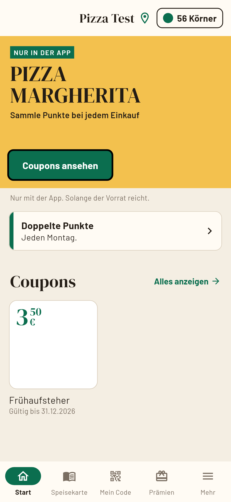
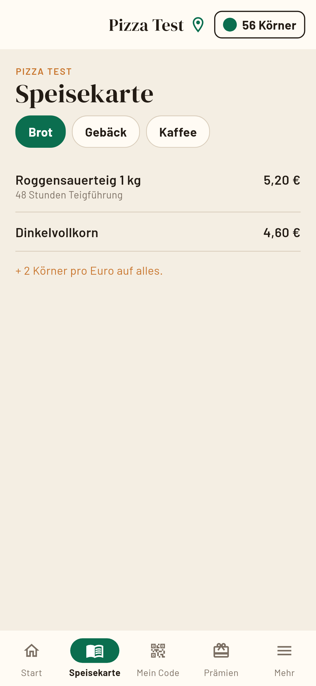
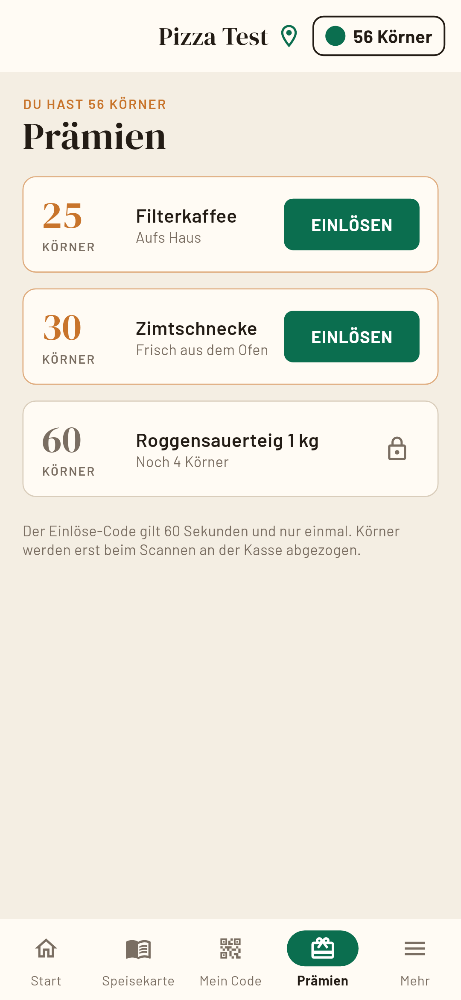
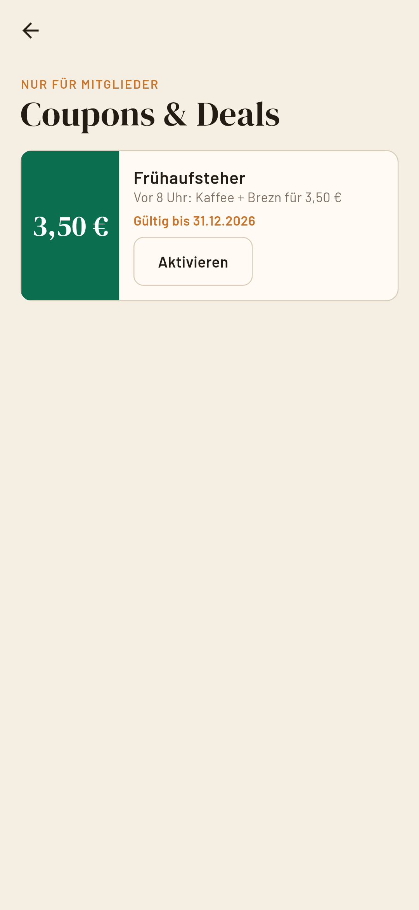
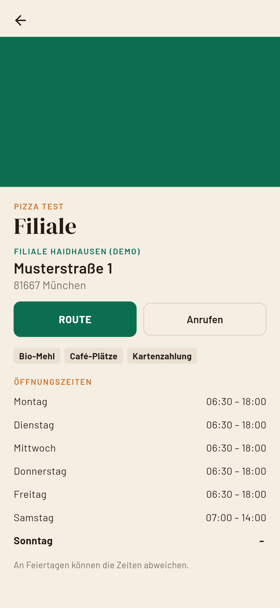

# Restaurant Loyalty App + App Studio 🍕⭐

A **white-label loyalty app** for restaurants, bakeries and cafés, built with **Flutter** (Android + iOS) – plus a local **"App Studio"** web tool to create and brand a new app (colors, fonts, logo, menu, rewards, coupons, locations) without touching code, and build a signed APK with one click.

> 🤖 **Built with AI-assisted development (vibe coding).** I designed the features, tested them and iterated on the result; most of the code was written together with an AI coding assistant.

## Screenshots (fictional demo tenant "Pizza Test")

    

## Features

**Customer app**
- 🎟️ Digital stamp/points card with personal QR member code
- 🎁 Rewards catalogue and QR redemption
- 🏷️ Coupons & deals, campaign banners, news feed
- 📋 Menu with categories, prices and images
- 📍 Locations with opening hours, map & phone links
- 🔔 Local push notifications (demo), history, settings, onboarding

**Staff side**
- 📷 QR scanner (staff PIN protected) to credit purchases / redeem rewards

**App Studio** (`studio/`, Python + HTML)
- Create tenants, edit everything in a form with a **live preview**
- Build a signed Android APK, export the iOS project, generate real Flutter screenshots

**Multi-tenant architecture** – one codebase, each brand = `tenants/<id>/tenant.json` + assets. Data layer behind a `LoyaltyRepository` interface (local storage now, ready for a Supabase backend).

## Tech stack

Flutter / Dart 3 · `shared_preferences` · `qr_flutter` · `mobile_scanner` · `flutter_local_notifications` · Python (App Studio server, Pillow) · Bash build scripts

## Build & run

Requirements: Flutter SDK, Android SDK (and a Mac with Xcode for iOS).

```bash
python3 tools/apply_tenant.py backstube-demo   # activate a tenant (writes assets, icons, android/tenant.properties)
flutter pub get
flutter run

./start_studio.sh                              # App Studio on http://localhost:8787
tools/build_apk.sh <tenant-id>                 # signed APK -> dist/ (creates a keystore in keystores/, git-ignored)
```

Included tenants are **fictional demos** (`backstube-demo`, `test-pizza`). German docs: [`docs/README_DE.md`](docs/README_DE.md), iOS build: [`docs/MAC_ANLEITUNG.md`](docs/MAC_ANLEITUNG.md).

## License

[MIT](LICENSE) © 2026 Bartuan3600 (bundled fonts are under the SIL Open Font License)
